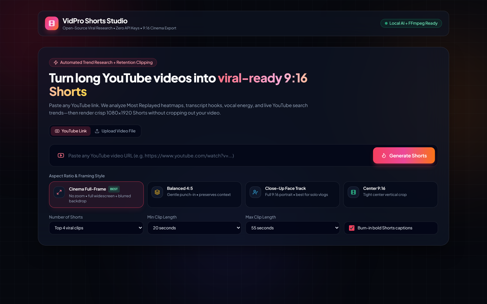
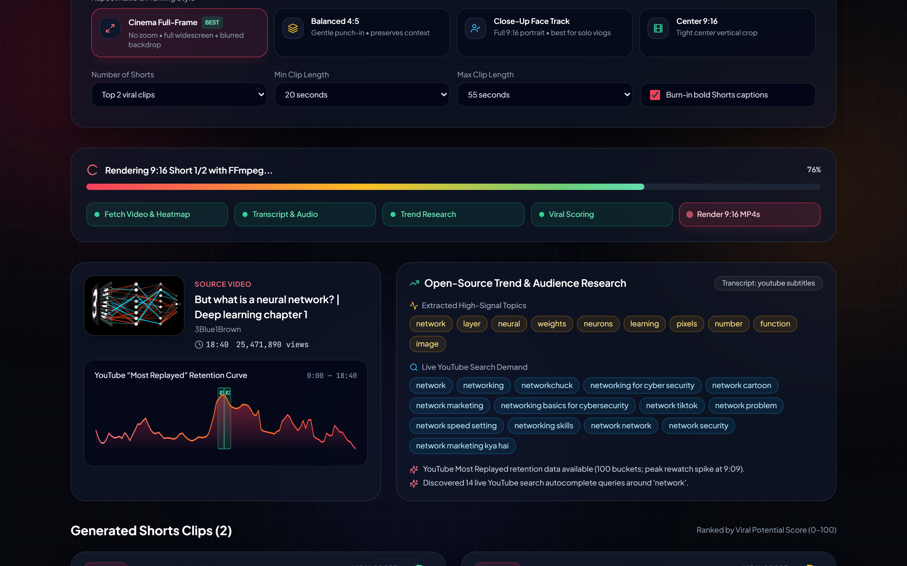
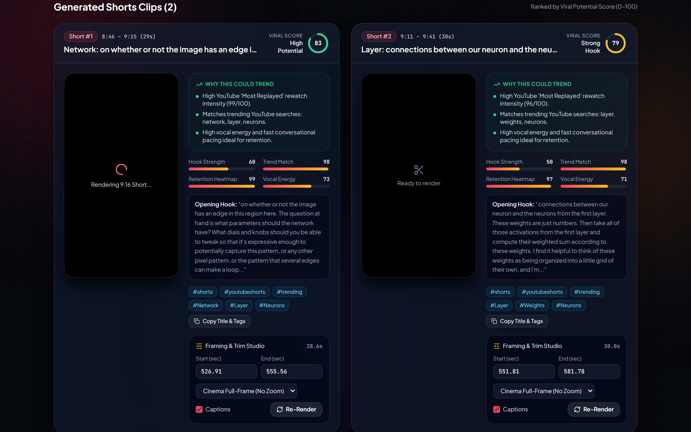

# VidPro Shorts Studio

> **100% Open-Source, Zero-API-Key AI YouTube Shorts Research & Vertical Clip Studio**  
> Turn long-form YouTube videos (or uploaded MP4s) into high-retention **9:16 vertical Shorts** backed by live trend research, audience retention heatmaps, and automated FFmpeg rendering.

### 🚀 Live Demo
Try the live deployed app here: **[https://vidpro-shorts-studio.vercel.app](https://vidpro-shorts-studio.vercel.app)**

---

## Live Preview & Screenshots

### 1. Studio Landing & Aspect-Ratio Framing Controls


### 2. Open-Source Trend Research & "Most Replayed" Retention Curve


### 3. Generated 9:16 Shorts with Viral Score Breakdown & Trim Studio


---

## Key Features

- **Zero Paid API Keys Required**: Runs completely on open-source tooling (`yt-dlp`, `youtube-transcript-api`, `faster-whisper`, `scikit-learn`, `OpenCV`, `FFmpeg`, and public YouTube Autocomplete / Google Trends feeds).
- **Multi-Signal Viral Moment Detection**:
  - **YouTube "Most Replayed" Heatmap**: Detects rewatch intensity peaks directly from YouTube retention buckets.
  - **Live Search Demand Research**: Extracts TF-IDF topics from transcripts and cross-checks live YouTube Search Autocomplete & Google Trends RSS.
  - **5-Axis Viral Scoring (0–100)**: Evaluates *Hook Strength*, *Trend Alignment*, *Retention Heatmap*, *Vocal Energy (RMS)*, and *Pacing Completeness*.
- **No-Zoom Aspect Ratio Framing (`1080×1920`)**:
  - **Cinema Full-Frame (`blur_fill`, default)**: Preserves 100% of widescreen content over an ambient blurred 9:16 backdrop with captions placed cleanly below the frame.
  - **Balanced 4:5 Portrait (`hybrid_fit`)**: Gentle speaker-centered portrait crop + ambient backdrop.
  - **Close-Up Face Track (`smart_face`)**: OpenCV face-tracking vertical crop for solo talking-head videos.
  - **Center Crop (`center`)**: Standard center 9:16 cut.
- **Interactive Trim & Re-Render**: Adjust Start/End timestamps, switch framing modes, toggle burned-in `.ass` Shorts captions, preview in-browser, and download H.264/AAC MP4s.
- **YouTube Link + Direct Video Upload Fallback**: Supports both YouTube URLs and direct `.mp4`/`.mov`/`.webm` file uploads (`faster-whisper` local transcription).

---

## Tech Stack

| Layer | Technologies |
|---|---|
| **Frontend** | Next.js 15 (App Router), React 19, TypeScript, Tailwind CSS, Lucide Icons |
| **Backend** | Python, FastAPI, Uvicorn, Pydantic |
| **Video & Audio** | `yt-dlp` (+ `yt-dlp-ejs` / Node.js JS runtime), `FFmpeg`, `OpenCV`, `NumPy` |
| **NLP & Trends** | `scikit-learn` (TF-IDF), `youtube-transcript-api`, `faster-whisper`, `httpx` |

---

## Running Locally

### Prerequisites
- Python 3.10+
- Node.js 18+ (also used by `yt-dlp` for YouTube JS challenge solving)
- FFmpeg installed on `PATH`

### 1. Start the Backend
```bash
cd backend
pip install -r requirements.txt
python -m uvicorn app.main:app --reload --port 8000
```

### 2. Start the Frontend
```bash
cd frontend
npm install
npm run dev
```

Or on Windows PowerShell, run `.\start.ps1` from the project root and open `http://localhost:3000`.
